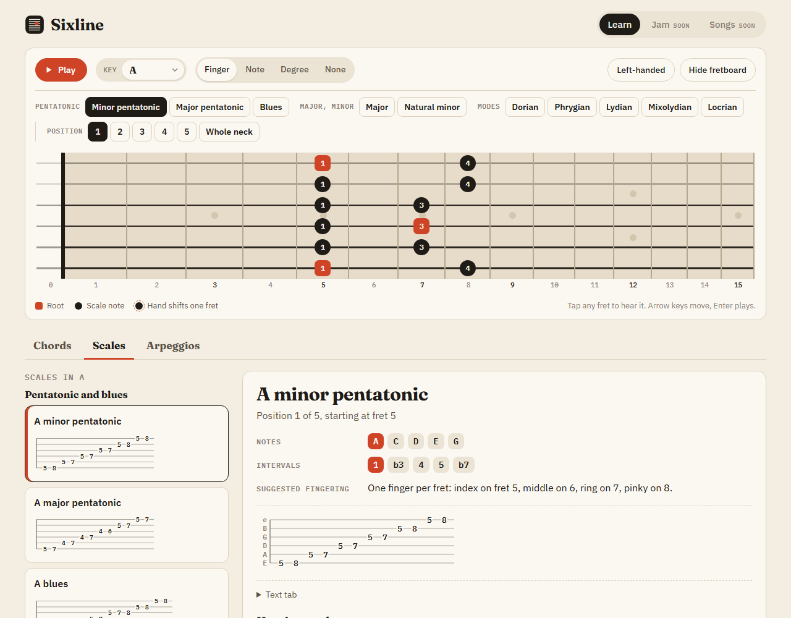
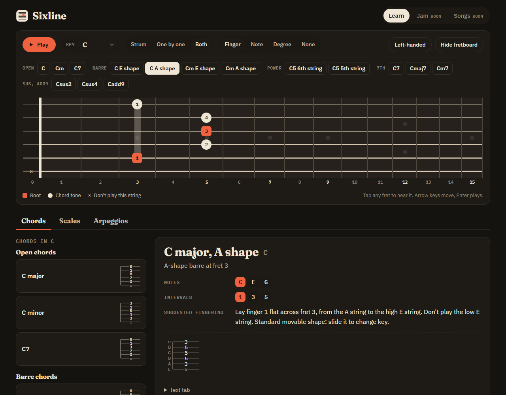
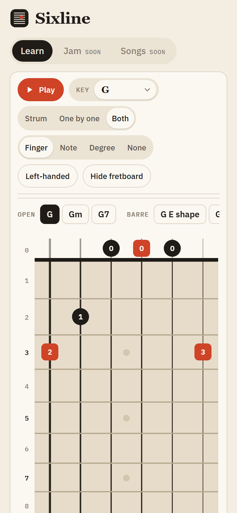

# Sixline

A free, interactive guitar fretboard for people who read tab, not standard notation. Pick a chord, scale, or arpeggio in any key, see it on the neck, hear it, and read it as tab.

**Try it:** https://ethanmanco.github.io/sixline/



## What it is

Sixline is the first phase of a guitar learning app built around one interactive fretboard. This phase is **Learn**: a reference you can play with.

- **Chords:** open chords, E-shape and A-shape barre chords, power chords, 7th chords (dominant, major 7, minor 7), sus2, sus4, and add9.
- **Scales:** major and minor pentatonic in all five positions, blues, major, natural minor, and the modes (Dorian, Phrygian, Lydian, Mixolydian, Locrian).
- **Arpeggios:** major, minor, dominant 7, major 7, minor 7, minor 7 flat 5, and diminished 7.
- **Any key:** the key picker regenerates everything from music theory. Nothing is a hand-typed table.

Every item comes with its notes, intervals, a fingering, a tab preview, and a short plain-English note on how it sounds and when to use it.



## The fretboard

- Six strings in standard tuning, frets 0 to 15. Horizontal on wide screens, and vertical like a chord chart on a phone held upright.
- Dots can show finger numbers (1 to 4, T for thumb), note names, scale degrees (1, b3, 5...), or nothing.
- Tap any fret to hear it. **Play** runs the selected shape and lights each dot and tab column as it sounds. Chords can play as a strum, one string at a time, or both.
- Left-handed mode mirrors the neck. The fretboard can be hidden.
- A row of quick-pick buttons sits right above the neck, so switching from A to A7 to Amaj7 takes one click each and no scrolling.
- Every shape also has a plain-text tab you can copy.



## How fingerings are chosen

Chord fingerings come from [chords-db](https://github.com/tombatossals/chords-db). Scale and arpeggio fingerings are generated by rules and labeled "Suggested fingering":

- **Pentatonic positions:** position 1 starts on the root on the low E string, and each position after it starts on the next scale note. Two notes per string, chosen by pitch, so the B string's tuning works out on its own.
- **Seven-note scales and arpeggios:** one finger per fret in a four-fret window, index on the first fret. Where a note falls in the one-fret gap between strings, the index reaches back one fret on the higher string, and the dot gets a dashed ring.
- **Blues:** the minor pentatonic boxes with the flat 5 added where it falls.
- **Barre and power chords:** the standard movable shapes, slid to the root. They use the chords-db fingering whenever chords-db has the same voicing.
- **Readable spelling:** if a key would need awkward names, the root is respelled. Db dorian shows as C# dorian.

A few chords-db voicings contain a note that is not in the chord, or a fretted note with no finger. Sixline leaves those out rather than show a mistake.

## Accessibility

- The fretboard is a keyboard grid: arrow keys move, Home and End jump along a string, Enter or Space plays.
- Every position has a spoken label, like "B string, fret 5, E, finger 1, degree 5".
- Root notes are squares and other notes are circles, so color is never the only cue.
- Sound only starts after you click, tap, or press a key.
- Animations turn off when your system asks for reduced motion.

## Roadmap

1. **Learn** (this version): chords, scales, and arpeggios in any key on an interactive fretboard.
2. **Jam:** play along with backing grooves while the fretboard shows what fits.
3. **Songs:** read and play through songs in tab with synced playback.

Also planned for later:

- Accounts
- Progress tracking
- Techniques like bends and slides
- Strumming patterns

## Run it locally

```bash
npm install
npm run dev
```

```bash
npm test
```

The tests check every scale, chord, and arpeggio in all 12 keys against formulas written out by hand, plus the fingering rules and the textbook pentatonic boxes.

## How the code is laid out

The fretboard, audio, and theory pieces do not know about Learn, so Jam and Songs can reuse them.

```
src/
  theory/     tuning, note spelling, scales, chords, keys (uses tonal)
  fingering/  position and finger rules
  chords/     chords-db adapter and movable shapes
  shapes/     turns theory plus fingering into shapes the UI can draw
  audio/      shared guitar sound (Tone.js)
  fretboard/  the interactive neck
  tab/        tab previews
  learn/      the Learn section
  app/        shell, routes, settings, the fretboard stage
```

## Credits and licenses

- **Chord fingerings:** [chords-db](https://github.com/tombatossals/chords-db) by David Rubert, MIT License, Copyright (c) 2016 David Rubert.
- **Guitar sound:** steel-string acoustic guitar notes from the FluidR3_GM rendering in [midi-js-soundfonts](https://github.com/gleitz/midi-js-soundfonts) by Benjamin Gleitzman. That project releases the FluidR3_GM rendering under [Creative Commons Attribution 3.0](https://creativecommons.org/licenses/by/3.0/). The original Fluid (R3) General MIDI SoundFont is Copyright (c) 2000-2002, 2008 Frank Wen and released under the MIT License. The 40 note files are unmodified; full credits are in [public/samples/guitar/CREDITS.txt](public/samples/guitar/CREDITS.txt).
- **Music theory:** [tonal](https://github.com/tonaljs/tonal), MIT License, Copyright (c) 2015 danigb.
- **Audio engine:** [Tone.js](https://github.com/Tonejs/Tone.js), MIT License, Copyright (c) 2014-2020 Yotam Mann.
- **Fonts:** Fraunces, IBM Plex Sans, and IBM Plex Mono from Google Fonts, under the SIL Open Font License.

All descriptions, diagrams, and fingerings are written or generated for Sixline. No text, diagrams, or lessons were copied from other websites.

Built with Claude Code. I designed, directed, reviewed, and tested it.
